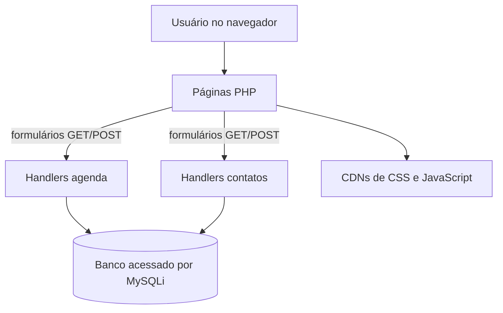

# Visão geral da arquitetura

## Resumo

O sistema é uma aplicação web PHP sem framework identificado. As páginas sob `agendamentos/paginas/` combinam apresentação HTML com código PHP: páginas de formulário/listagem, handlers que recebem `GET` ou `POST` e uma configuração compartilhada que abre conexão `mysqli`.

O diagrama representa as chamadas identificadas no código; não confirma a infraestrutura, o servidor web ou o produto/versão do banco em produção.

## Componentes confirmados

- **Interface e navegação:** `index.php`, formulários e listagens compõem as telas e a navegação.
- **Agenda:** consultas e gravações usam a tabela `agendaa`; detalhes em [[02 - Modulos/Agenda|Módulo Agenda]].
- **Contatos:** consultas e gravações usam a tabela `contatos`; detalhes em [[02 - Modulos/Contatos|Módulo Contatos]].
- **Conexão compartilhada:** `config.php` define parâmetros de conexão e `$conexao` via `mysqli_connect`. Os valores sensíveis não são documentados.
- **Persistência:** as consultas SQL são escritas diretamente nos arquivos PHP; não há camada de repositório ou ORM identificada.

## Relações e limitações

Não há autenticação, API separada, framework ou modelo de domínio formal visível nos arquivos examinados. A relação entre compromissos e contatos não é persistida nas consultas observadas: o campo de convidado da interface apresenta opções estáticas e a listagem de agenda imprime um rótulo literal.

Para a estrutura física e os limites das evidências, consulte [[04 - Dados/Modelo de Dados|Modelo de dados]] e [[08 - Pendencias/Pontos de Atencao|Pontos de atenção]].

## Referências do repositório

- [agendamentos/paginas/index.php](../../../agendamentos/paginas/index.php)
- [agendamentos/paginas/config.php](../../../agendamentos/paginas/config.php)
- [agendamentos/paginas/listar_agenda.php](../../../agendamentos/paginas/listar_agenda.php)
- [agendamentos/paginas/listar_contatos.php](../../../agendamentos/paginas/listar_contatos.php)

[[01 - Arquitetura/Indice|Índice de Arquitetura]]
