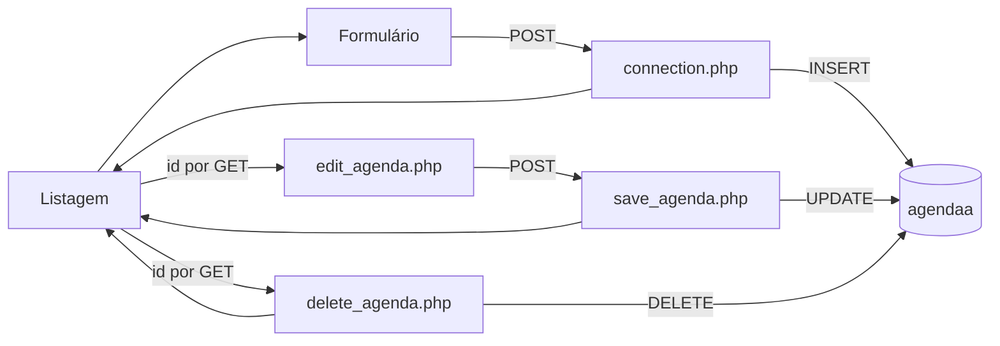

# Ciclo de Agenda

## Cadastro

1. A partir do painel ou da listagem, o usuário abre `form_agenda.php`.
2. O formulário envia `titulo1`, `data1`, `hora1`, `data2`, `hora_2`, `local_1` e `description` por POST para `connection.php`.
3. `connection.php` carrega `config.php`, executa INSERT em `agendaa` e redireciona para `listar_agenda.php`.

## Edição

1. A listagem constrói o link para `edit_agenda.php?id=...`.
2. `edit_agenda.php` consulta o registro por `id` e preenche o formulário.
3. O formulário envia os dados e o identificador por POST para `save_agenda.php`; esse handler atualiza a linha quando `update` está presente e redireciona para a listagem.

## Exclusão

O link da listagem abre `delete_agenda.php?id=...`. O handler consulta o registro, exclui se encontrar resultado e redireciona à listagem. A operação é disparada por GET e não há confirmação adicional no código examinado.

As consultas usam SQL construído por interpolação de valores. As implicações e outras pendências estão em [[08 - Pendencias/Pontos de Atencao|Pontos de atenção]].

## Referências

- [agendamentos/paginas/form_agenda.php](../../../agendamentos/paginas/form_agenda.php)
- [agendamentos/paginas/connection.php](../../../agendamentos/paginas/connection.php)
- [agendamentos/paginas/edit_agenda.php](../../../agendamentos/paginas/edit_agenda.php)
- [agendamentos/paginas/save_agenda.php](../../../agendamentos/paginas/save_agenda.php)
- [agendamentos/paginas/delete_agenda.php](../../../agendamentos/paginas/delete_agenda.php)

[[03 - Fluxos/Indice|Índice de Fluxos]]
