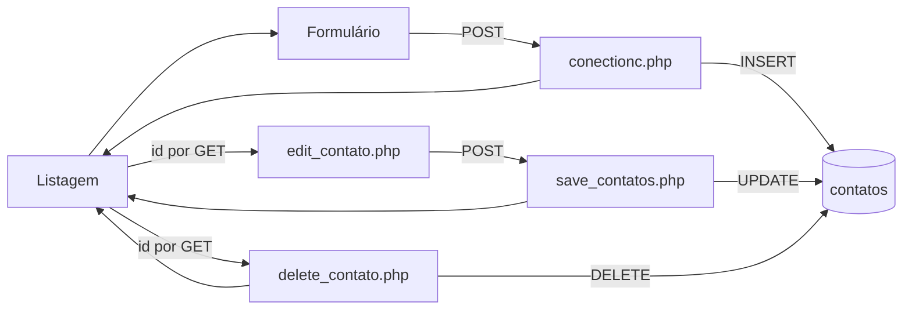

# Ciclo de Contatos

## Cadastro

1. O usuário abre `form_contatos.php`.
2. O formulário envia nome, sobrenome, telefones, tipos e email por POST para `conectionc.php`.
3. `conectionc.php` carrega a configuração compartilhada, insere os campos em `contatos` e redireciona para `listar_contatos.php`.

## Edição

1. A listagem constrói o link `edit_contato.php?id=...`.
2. A tela consulta o contato e apresenta seus campos no formulário.
3. O formulário envia os dados e `id` por POST para `save_contatos.php`; o handler executa UPDATE quando `update` está presente e redireciona para a listagem.

## Exclusão

O link abre `delete_contato.php?id=...`. O handler procura o registro, exclui caso exista e redireciona. A exclusão é acionada por GET, sem confirmação adicional visível.

## Referências

- [agendamentos/paginas/form_contatos.php](../../../agendamentos/paginas/form_contatos.php)
- [agendamentos/paginas/conectionc.php](../../../agendamentos/paginas/conectionc.php)
- [agendamentos/paginas/edit_contato.php](../../../agendamentos/paginas/edit_contato.php)
- [agendamentos/paginas/save_contatos.php](../../../agendamentos/paginas/save_contatos.php)
- [agendamentos/paginas/delete_contato.php](../../../agendamentos/paginas/delete_contato.php)

[[03 - Fluxos/Indice|Índice de Fluxos]]
