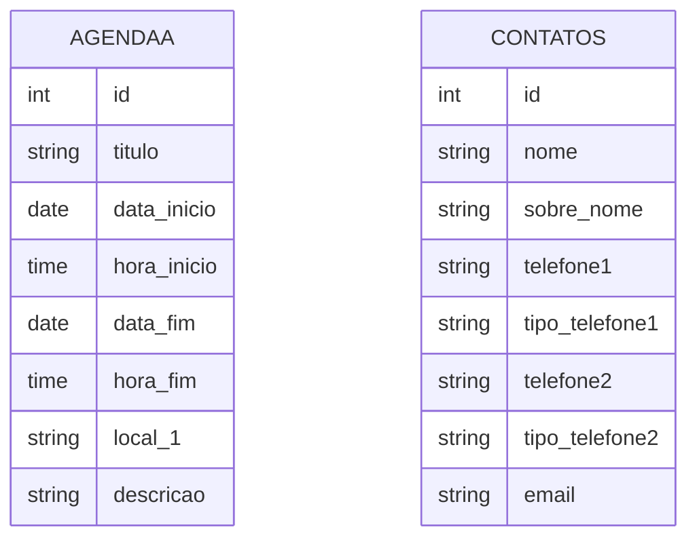

# Modelo de dados observado

## Evidência e confiança

Os campos abaixo são **confirmados como nomes usados pelo código** em consultas, gravações ou renderização. Não foi encontrado DDL, migração, dump ou documentação do banco; portanto tipos, nulabilidade, defaults, índices, chaves primárias efetivas e relacionamentos físicos não podem ser afirmados. `id` é usado como identificador, mas sua definição no banco não foi examinada.

O diagrama resume os nomes/categorias inferidos dos controles e consultas; não é esquema SQL validado.

## Entidade `agendaa`

| Campo usado no código | Uso observado |
|---|---|
| `id` | Seleção, edição, exclusão e ordenação. |
| `titulo` | Título do compromisso. |
| `data_inicio`, `hora_inicio` | Início informado no formulário. |
| `data_fim`, `hora_fim` | Fim informado no formulário. |
| `local_1` | Local do compromisso. |
| `descricao` | Descrição recebida do formulário. |

Referências: INSERT em `connection.php`, UPDATE em `save_agenda.php`, SELECT/DELETE em `edit_agenda.php` e `delete_agenda.php`, listagem em `listar_agenda.php`.

## Entidade `contatos`

| Campo usado no código | Uso observado |
|---|---|
| `id` | Seleção, edição, exclusão e ordenação. |
| `nome`, `sobre_nome` | Nome e sobrenome. |
| `telefone1`, `tipo_telefone1` | Primeiro telefone e tipo selecionado. |
| `telefone2`, `tipo_telefone2` | Segundo telefone e tipo selecionado. |
| `email` | Endereço informado no formulário. |

Referências: INSERT em `conectionc.php`, UPDATE em `save_contatos.php`, SELECT/DELETE em `edit_contato.php` e `delete_contato.php`, listagem em `listar_contatos.php`.

## Relações

Não foi observada chave estrangeira ou consulta que una agenda a contato. O campo de convidado na tela de agenda é fixo e não faz parte dos INSERT/UPDATE identificados; não deve ser interpretado como relacionamento persistido.

[[04 - Dados/Indice|Índice de Dados]]
